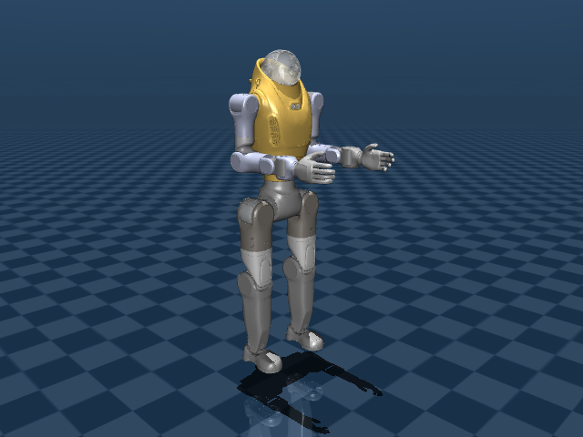
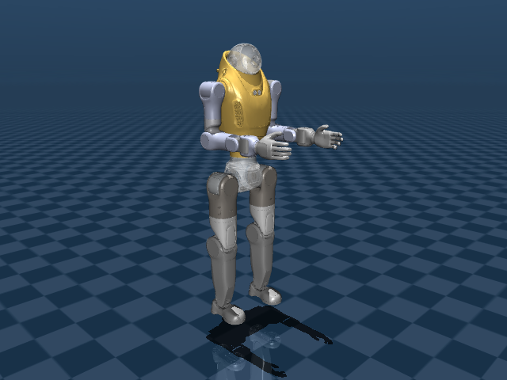
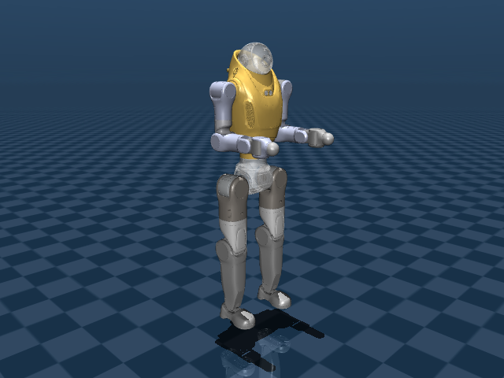
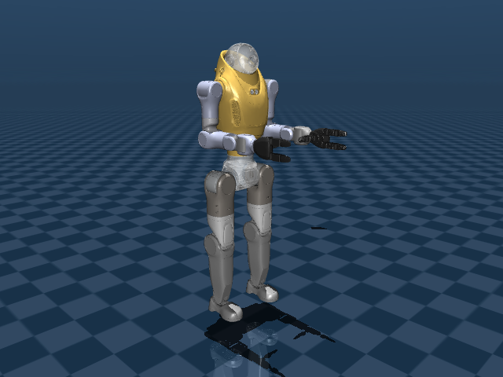

# Menagerie X

[](https://github.com/notAnyrobot/menagerie_x/actions/workflows/build.yml)

**Menagerie X** is a collection of robot models for the
[MuJoCo](https://github.com/google-deepmind/mujoco) physics engine. Its organization
follows [MuJoCo Menagerie](https://github.com/google-deepmind/mujoco_menagerie),
with the seven existing local robot families and their 11 native MJCF models.

Each model directory contains the robot description, a scene, local assets,
derivation notes, and licensing records. Source fidelity and available controls
vary by model; the individual READMEs describe those limits.

- [Getting Started](#getting-started)
- [Model Quality and Contributing](#model-quality-and-contributing)
- [Menagerie Models](#menagerie-models)
- [Acknowledgments](#acknowledgments)
- [Changelog](#changelog)
- [License and Disclaimer](#license-and-disclaimer)

## Getting Started

### Prerequisites

The repository pins native MuJoCo **3.11.0** and requires Python 3.12 or later.
The robot READMEs state the tested version; an older minimum version has not
been established for these local models. Install the checkout's dependencies
with [uv](https://docs.astral.sh/uv/):

```bash
git clone https://github.com/notAnyrobot/menagerie_x.git
cd menagerie_x
uv sync --locked --extra dev
```

### Overview

All robot families follow the same native organization. For example:

```text
astro_p1/
├── assets/                 # visual and collision meshes
├── astro_p1_30dof.xml       # robot definition
├── astro_p1_30dof.png       # scene preview
├── scene.xml               # includes the robot, adds ground and lighting
├── astro_p1_27dof.xml       # alternative model
├── scene_27dof.xml          # alternative scene
├── README.md
├── CHANGELOG.md
├── LICENSING.md            # actual notices/status; LICENSE.* where available
├── mjcf/                   # retained import snapshots
└── urdf/                   # retained URDF descriptions
```

Edit the family-root model and scene XML directly. Nested imports are preserved
source evidence; no regeneration step is required. Scenes keep each robot's
coordinate datum, with lowered floors for several zero-height models.

A family can be copied and loaded independently of the Python catalog or
application manifest. Keep its `assets/` directory and `meshes -> assets` link:
the preserved HHTools conversions still use that relative mesh path.

### Usage

Open a native scene in MuJoCo's interactive viewer:

```bash
uv run python -m mujoco.viewer --mjcf astro_p2/scene.xml
```

Or load it through the native Python bindings:

```python
import mujoco

model = mujoco.MjModel.from_xml_path("astro_p2/scene.xml")
data = mujoco.MjData(model)
mujoco.mj_step(model, data)
```

Scenes use native reference initialization. Select named keyframes explicitly;
for example, the Dex3-1 model's `fist` keyframe is not selected by a normal reset.

Workbench, URDF compatibility, and MJX remain deferred. Legacy application code
and metadata are retained, but may select old snapshots rather than native root
XML. Use top-level family paths: the stale `robots/` directory is retired.
See [UPSTREAM.md](UPSTREAM.md) for ownership and migration details.

## Model Quality and Contributing

`make all` checks native layout and XML style, loads and steps every declared
model and scene, checks existing keyframe reset, and loads standalone copied
family folders. CI runs the same native checks. See
[CONTRIBUTING.md](CONTRIBUTING.md) for editing and validation conventions.

These checks cover loading and short simulation; they do not certify a stable
controller, hardware dynamics, or every possible contact configuration. Some
models have no actuators. The Astro Dex3-1 hand mount is an unverified sample.

### Quick contributor setup

```bash
make install
make all
```

## Menagerie Models

**Humanoids.** DoF counts exclude the floating base. Click a preview to open its
scene XML, or a model name for its description. Images are native renders at
reference initialization, with collision overlays hidden and no simulation
stepping; collision alternatives can share the same visual appearance.

| Preview | Name | DoFs | License |
| :---: | --- | --- | --- |
| <a href="astro_p1/scene.xml"></a> | [Astro P1 (30 DoF)](astro_p1/README.md) | 30 | [Unresolved](astro_p1/LICENSING.md) |
| <a href="astro_p1/scene_27dof.xml"></a> | [Astro P1 (27 DoF)](astro_p1/README.md) | 27 | [Unresolved](astro_p1/LICENSING.md) |
| <a href="astro_p2/scene.xml"></a> | [Astro P2 (primitive collisions)](astro_p2/README.md) | 30 | [Unresolved](astro_p2/LICENSING.md) |
| <a href="astro_p2/scene_30dof_mesh_collision.xml"></a> | [Astro P2 (mesh collisions)](astro_p2/README.md) | 30 | [Unresolved](astro_p2/LICENSING.md) |
| <a href="astro_p2/scene_30dof_primitive_collision_halfway.xml"></a> | [Astro P2 (intermediate primitives)](astro_p2/README.md) | 30 | [Unresolved](astro_p2/LICENSING.md) |
| <a href="astro_p2_29dof/scene.xml"></a> | [Astro P2 (fixed head)](astro_p2_29dof/README.md) | 29 | [Unresolved](astro_p2_29dof/LICENSING.md) |
| <a href="astro_p2_43dof_dex3_1/scene.xml"></a> | [Astro P2 with Dex3-1 sample hands](astro_p2_43dof_dex3_1/README.md) | 43 | [BSD-3-Clause hands; body unresolved](astro_p2_43dof_dex3_1/LICENSING.md) |
| <a href="atom_p3/scene.xml"></a> | [Atom P3](atom_p3/README.md) | 27 | [Unresolved](atom_p3/LICENSING.md) |
| <a href="soma23/scene.xml"></a> | [SOMA-23](soma23/README.md) | 66 | [Apache-2.0](soma23/LICENSE.ProtoMotions) |
| <a href="unitree_g1/scene.xml"></a> | [Unitree G1 with hands](unitree_g1/README.md) | 43 | [BSD-3-Clause](unitree_g1/LICENSE.Unitree) |
| <a href="unitree_g1/scene_29dof_box_feet.xml"></a> | [Unitree G1 with box feet](unitree_g1/README.md) | 29 | [Apache-2.0 model; BSD-3-Clause meshes](unitree_g1/LICENSING.md) |

## Acknowledgments

This collection retains models and source material from Unitree Robotics,
NVIDIA ProtoMotions, and the existing Astro and Atom bundles. Family source
records identify the available revisions, hashes, modifications, and notices.

MuJoCo Menagerie provides the reference layout, XML formatter, and native
validation conventions. [UPSTREAM.md](UPSTREAM.md) records the pinned upstream
revision and the scope of copied or adapted material. Menagerie X is maintained
separately from Google DeepMind's collection.

## Changelog

Repository updates are recorded in [CHANGELOG.md](CHANGELOG.md). Each model
family also has a changelog linked from its README.

## License and Disclaimer

Models and assets retain their individual terms. The gallery links the relevant
license or provenance status for each model; the complete scope is recorded in
[LICENSING.md](LICENSING.md) and each family's licensing notes. Some Astro and
Atom bundles have unresolved redistribution terms. No new license is granted
to those assets by this documentation or layout refactor.

Copied or adapted upstream tooling retains its Apache-2.0 notices and
[license text](LICENSES/Apache-2.0.txt); presentation scenes retain their
[upstream G1 notice](LICENSES/MuJoCo-Menagerie-G1.txt). Model-specific licenses
do not extend to unrelated materials in the repository.
