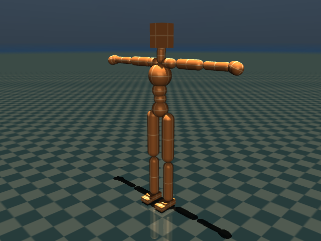
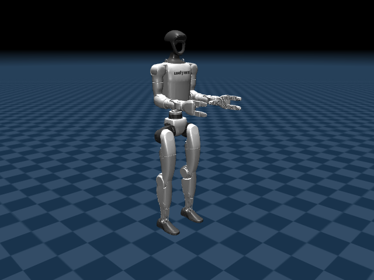
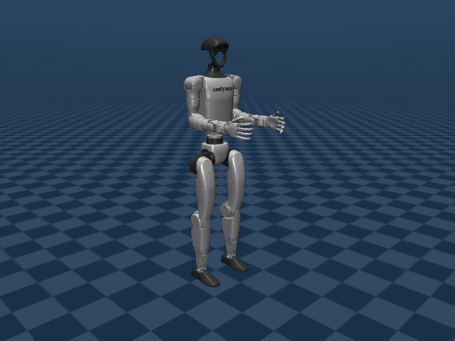
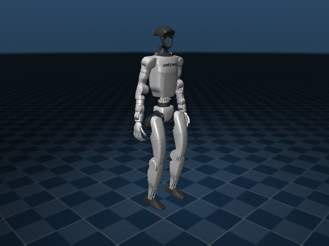

# Menagerie X

[](https://github.com/notAnyrobot/menagerie_x/actions/workflows/build.yml)

**Menagerie X** is a collection of robot models for the
[MuJoCo](https://github.com/google-deepmind/mujoco) physics engine. Its organization
follows [MuJoCo Menagerie](https://github.com/google-deepmind/mujoco_menagerie),
with four active robot families and eight native MJCF models. Astro P1 is
retained separately as legacy, pending retirement.

Each model directory contains the robot description, a scene, local assets,
derivation notes, and licensing records. Source fidelity and available controls
vary by model; the individual READMEs describe those limits.

- [Getting Started](#getting-started)
- [Model Quality and Contributing](#model-quality-and-contributing)
- [Menagerie Models](#menagerie-models)
- [Legacy Models](#legacy-models)
- [Acknowledgments](#acknowledgments)
- [Changelog](#changelog)
- [License and Disclaimer](#license-and-disclaimer)

## Getting Started

### Prerequisites

The repository pins native MuJoCo **3.11.0** and requires Python 3.12 or later.
The robot READMEs state the tested version; an older minimum version has not
been established for these local models. Install the checkout's dependencies
with [uv](https://docs.astral.sh/uv/):

```bash
git clone https://github.com/notAnyrobot/menagerie_x.git
cd menagerie_x
uv sync --locked --extra dev
```

### Overview

All robot families follow the same native organization. For example:

```text
astro_p2/
├── assets/                 # shared Astro and Unitree hand meshes
├── astro_p2.xml            # default 29-DoF model
├── astro_p2.png            # scene preview
├── scene.xml               # default scene
├── astro_p2_with_hands.xml  # same body plus 14 Dex3-1 finger DoFs
├── scene_with_hands.xml     # dexterous-hand scene
├── astro_p2_simplified.xml  # original body colliders, optimized arms/hands
├── scene_simplified.xml     # explicit arm contacts, original body contact policy
├── README.md
├── CHANGELOG.md
├── LICENSE                 # Apache-2.0 for Astro material
├── LICENSING.md
├── LICENSE.Unitree
└── provenance/             # original source/conversion records
```

Edit the family-root model and scene XML directly. Retained imports and
`provenance/` records are source evidence; no regeneration step is required. Scenes keep each robot's
coordinate datum, with lowered floors for several zero-height models.

A family can be copied and loaded independently of the Python catalog or
application manifest. Keep its `assets/` directory. Other retained descriptions
may also use a family-local `meshes -> assets` link.

### Usage

Open a native scene in MuJoCo's interactive viewer:

```bash
uv run python -m mujoco.viewer --mjcf astro_p2/scene.xml
```

Or load it through the native Python bindings:

```python
import mujoco

model = mujoco.MjModel.from_xml_path("astro_p2/scene.xml")
data = mujoco.MjData(model)
mujoco.mj_step(model, data)
```

Scenes use native reference initialization. Select named keyframes explicitly;
for example, the Astro P2 with hands model's `fist` keyframe is not selected by a
normal reset. The G1 primitive scene supplies `home` and `knees_bent` poses.

Workbench, URDF compatibility, and MJX remain deferred. Legacy application code
and metadata are retained, but may select old snapshots rather than native root
XML. Use top-level family paths: the stale `robots/` directory is retired.
See [UPSTREAM.md](UPSTREAM.md) for ownership and migration details.

## Model Quality and Contributing

`make all` checks native layout and XML style, loads and steps every declared
active and legacy model/scene, checks the shared Astro body and hand sources,
checks the G1 primitive source hashes and contact contract, checks existing
keyframe reset, and loads standalone copied
family folders. CI runs the same native checks. See
[CONTRIBUTING.md](CONTRIBUTING.md) for editing and validation conventions.

These checks cover loading and short simulation; they do not certify a stable
controller, hardware dynamics, or every possible contact configuration. Some
models have no actuators. The Astro Dex3-1 hand mount is an unverified sample.

### Quick contributor setup

```bash
make install
make all
```

## Menagerie Models

**Humanoids.** DoF counts exclude the floating base. Click a preview to open its
scene XML, or a model name for its description. Images are native renders with
collision overlays hidden and no simulation stepping. The G1 primitive preview
uses its scene's `home` keyframe; other previews use reference initialization.
Collision alternatives can share the same visual appearance.

| Preview | Name | DoFs | License |
| :---: | --- | --- | --- |
| <a href="astro_p2/scene.xml"></a> | [Astro P2](astro_p2/README.md) | 29 | [Apache-2.0](astro_p2/LICENSE) |
| <a href="astro_p2/scene_with_hands.xml"></a> | [Astro P2 with hands](astro_p2/README.md) | 43 | [Apache-2.0 body; BSD-3-Clause hands](astro_p2/LICENSING.md) |
| <a href="astro_p2/scene_simplified.xml"></a> | [Astro P2 with optimized arm collisions](astro_p2/README.md) | 29 | [Apache-2.0 model; BSD-3-Clause scene](astro_p2/LICENSING.md) |
| <a href="atom_p3/scene.xml"></a> | [Atom P3](atom_p3/README.md) | 27 | [Unresolved](atom_p3/LICENSING.md) |
| <a href="soma23/scene.xml"></a> | [SOMA-23](soma23/README.md) | 66 | [Apache-2.0](soma23/LICENSE.ProtoMotions) |
| <a href="unitree_g1/scene.xml"></a> | [Unitree G1 with hands](unitree_g1/README.md) | 43 | [BSD-3-Clause](unitree_g1/LICENSE.Unitree) |
| <a href="unitree_g1/scene_29dof_box_feet.xml"></a> | [Unitree G1 with box feet](unitree_g1/README.md) | 29 | [Apache-2.0 model; BSD-3-Clause meshes](unitree_g1/LICENSING.md) |
| <a href="unitree_g1/scene_mjx.xml"></a> | [Unitree G1 with primitive collisions](unitree_g1/README.md) | 29 | [BSD-3-Clause](unitree_g1/LICENSE.Menagerie) |

All Astro P2 variants have the same fixed-head, 29-DoF body. Dex3-1 adds 14
finger joints (43 total). The additional arm-optimized model retains the default
model's fixed hands, visuals and all non-arm colliders, including the original
feet and torso. Only the arm/hand collision envelope is simplified, with its
interactions explicitly selected in the scene. Other body contacts retain the
original automatic policy. Arms use 10 shapes instead of 20; the full model has
50 colliders. The existing detailed variants remain
available. See the [collision-only preview](astro_p2/astro_p2_simplified_colliders.png).
The previous 30-DoF primitive, mesh, and intermediate
P2 descriptions are retired; their history remains in Git. The formerly
separate Astro 29 and Dex3-1 folders are consolidated into `astro_p2/`.

The new G1 primitive configuration matches MuJoCo Menagerie's MJX model: 27
robot collision geoms and 49 explicit scene contact pairs. It retains upstream
position servos, numerical settings, sensors, and poses. Existing G1 variants
remain available. Native MuJoCo loading is verified; MJX runtime support remains
deferred. Use `scene_mjx.xml` for its floor contacts and saved poses.

## Legacy Models

[Astro P1](astro_p1/README.md) is **legacy and scheduled for retirement**. Its
[30-DoF](astro_p1/scene.xml) and [27-DoF](astro_p1/scene_27dof.xml) models remain
available and receive native loading checks until removal. They are excluded
from the active gallery and active model map. Use Astro P2 for new work.

## Acknowledgments

This collection retains models and source material from Unitree Robotics,
NVIDIA ProtoMotions, and the existing Astro and Atom bundles. Family source
records identify the available revisions, hashes, modifications, and notices.

MuJoCo Menagerie provides the reference layout, XML formatter, and native
validation conventions. [UPSTREAM.md](UPSTREAM.md) records the pinned upstream
revision and the scope of copied or adapted material. Menagerie X is maintained
separately from Google DeepMind's collection.

## Changelog

Repository updates are recorded in [CHANGELOG.md](CHANGELOG.md). Each model
family also has a changelog linked from its README.

## License and Disclaimer

Models and assets retain their individual terms. The gallery links the relevant
license or provenance status for each model; the complete scope is recorded in
[LICENSING.md](LICENSING.md) and each family's licensing notes. The Astro P2 body
and default model use Apache-2.0; Unitree hand material retains BSD-3-Clause
terms. Legacy Astro P1 and Atom bundles retain their recorded
unresolved status.

Copied or adapted upstream tooling retains its Apache-2.0 notices and
[license text](LICENSES/Apache-2.0.txt); presentation scenes retain their
[upstream G1 notice](LICENSES/MuJoCo-Menagerie-G1.txt). Model-specific licenses
do not extend to unrelated materials in the repository.
