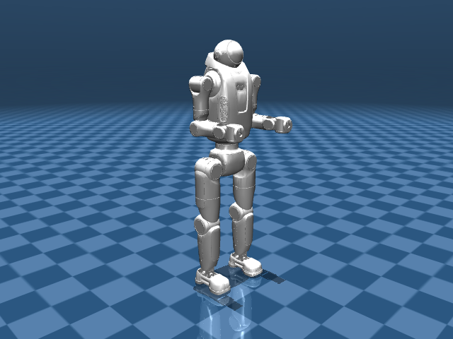

# Astro P1 Description (MJCF, Legacy)

> [!IMPORTANT]
> Tested with MuJoCo 3.11.0, the version pinned by this repository.

> [!WARNING]
> **Legacy:** retained for reference and scheduled for retirement. Use the
> maintained [Astro P2 family](../astro_p2/README.md) for new work. The P1 models
> remain available and continue to receive native loading checks until removal.

## Changelog

Model history: [CHANGELOG.md](CHANGELOG.md).

## Overview

This directory contains the retained 27- and 30-DoF descriptions of the Astro P1
humanoid. The original URDF and MJCF imports are preserved under `urdf/` and
`mjcf/`; a complete public upstream source record is not available.

  
  

| Model | DoFs | Scene |
| --- | --- | --- |
| [astro_p1_30dof.xml](astro_p1_30dof.xml) | 30 | [scene.xml](scene.xml) |
| [astro_p1_27dof.xml](astro_p1_27dof.xml) | 27 | [scene_27dof.xml](scene_27dof.xml) |

DoF counts exclude the floating base. Open the scene to include the robot,
ground plane, and lighting. The images show native reference initialization,
without advancing simulation.

## MJCF derivation steps

1. Started from the retained [30-DoF MJCF](mjcf/astro_p1_30dof.xml) and [27-DoF MJCF](mjcf/astro_p1_27dof.xml) imports.
2. Placed the native robot XML at the family root and pointed mesh lookup at `assets/`.
3. Preserved the imported bodies, inertias, joint definitions, actuators, and sensors.
4. Added sibling scene files containing a ground plane at `z=0` and presentation lighting.

## Model notes

The models have 30 and 27 actuators respectively. Their imported gains are
retained; short load/step checks do not establish a tuned controller.

Retained URDFs: [30 DoF](urdf/astro_p1_30dof.urdf),
[27 DoF](urdf/astro_p1_27dof.urdf), and
[with racket](urdf/astro_p1_with_racket.urdf). The racket variant has no native
MJCF entry. Maintain the root XML directly; nested MJCF files are source
snapshots.

## License

The retained Astro bundle has no explicit redistribution license or complete
public provenance record. See [LICENSING.md](LICENSING.md) for the recorded status
and the separate terms for presentation scenes.
