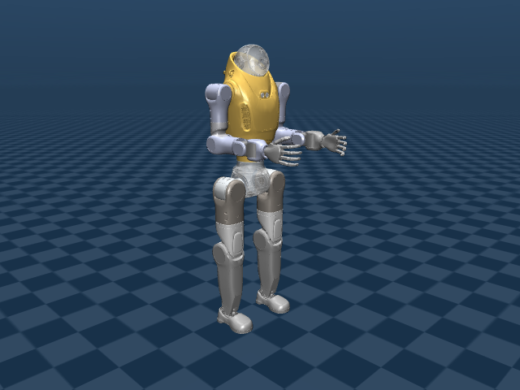
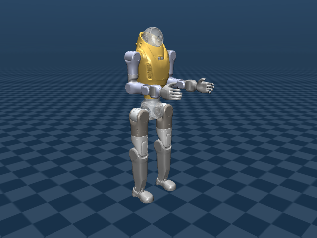
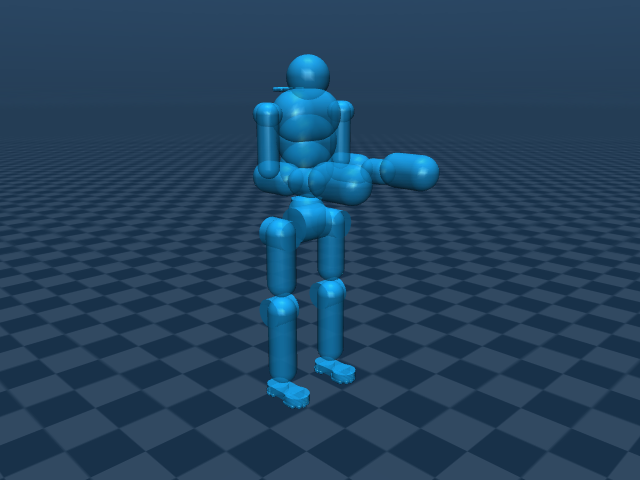
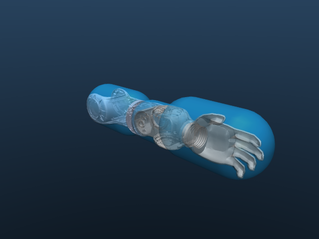

# Astro P2 Description (MJCF)

> [!IMPORTANT]
> Tested with MuJoCo 3.11.0, the version pinned by this repository.

## Changelog

Model history: [CHANGELOG.md](CHANGELOG.md).

## Overview

This family contains one fixed-head Astro P2 body with two hand configurations
and an additional arm-optimized collision variant of the default model, following
the sibling-model and scene pattern used by Unitree G1. All variants share the
latest refined **29-DoF body**. The default Astro P2 model has 29
DoFs; the articulated Unitree Dex3-1 alternative adds 14 finger DoFs for
**43 total**. The articulated configuration is labeled **Astro P2 with hands**;
its Dex3-1 visual meshes use silver coloring to match the Astro body.

  
  
  

| Model | Body DoFs | Hand DoFs | Scene |
| --- | --- | --- | --- |
| [astro_p2.xml](astro_p2.xml) — Astro P2 | 29 | 0 | [scene.xml](scene.xml) |
| [astro_p2_with_hands.xml](astro_p2_with_hands.xml) — Astro P2 with hands | 29 | 14 | [scene_with_hands.xml](scene_with_hands.xml) |
| [astro_p2_simplified.xml](astro_p2_simplified.xml) — Astro P2 with optimized arm collisions | 29 | 0 | [scene_simplified.xml](scene_simplified.xml) |

DoF counts exclude the floating base. Previews show native reference
initialization without simulation stepping, with collision overlays hidden.

## MJCF derivation steps

1. Retained the latest refined Astro/Dex3-1 MJCF as the common body baseline,
   preserving non-hand geometry, masses, inertias, joints, and collision settings.
2. Consolidated model variants and shared meshes into this family directory,
   with each scene including its sibling robot XML and a floor at `z=-0.75`.
3. For the default model, restored the original Astro left/right hand
   meshes, fixed-joint transforms, masses, and inertia tensors from the retained
   source revision. Restored the original hand collision cylinders/end spheres
   as equivalent native capsules. All 29 body joints and refined wrist housing
   collisions remain unchanged. The earlier G1 hand trial was superseded.
4. For the Dex3-1 variant, retained its 14 finger joints, collision refinements,
   and native `fist` keyframe. The renamed model retains its physical definition.
5. Preserved original conversion reports, URDFs, source XML, and licensing
   evidence under [provenance/](provenance/). Retired the former 30-DoF P2 choices.
6. Added a separate default-hand collision alternative inspired by Menagerie's
   explicit contact selection. After visual review, retained all original
   non-arm colliders and narrowed optimization to the arms and hands. Neither
   existing variant was replaced or retuned.

## Model notes

None of these models supplies actuators or gains. Astro P2 and the simplified
variant have `nq=36` and `nv=35`; the Dex3-1 model has `nq=50` and `nv=49`.
Select `fist` explicitly for the saved Dex3-1 closure; ordinary reset uses the
reference configuration.

The Dex3-1 variant still uses **sample attachments**, not verified mechanical
adapters. No hand calibration, retargeting, or hardware control is supplied.

Astro P2 weighs **40.58255359 kg**. Its source mesh hashes,
hand inertias, transforms, and capsule conversion are recorded in
[provenance/rubber_hands.json](provenance/rubber_hands.json). See the
[model restoration record](../docs/astro-native-hand-restoration.md).

## Optimized arm collision configuration

**Astro P2 with optimized arm collisions** preserves every original non-arm
collider: pelvis, hips, legs, detailed feet, torso/neck and head. Only the arm
and hand collision envelope is reduced, from **20 to 10 shapes** (five per arm).
The complete model has **50 colliders: 40 unchanged body shapes plus 10 arm
capsules**. All 37 visual mesh geoms and the
fixed-head 29-joint body remain unchanged. This variant uses Astro's original
fixed hands; no optimized articulated-hand version is introduced.
Collider dimensions, attachments and source hashes are recorded in
[provenance/simplified_collisions.json](provenance/simplified_collisions.json).
The model retains the default mass of **40.58255359 kg**,
zero actuators, 0.002 s timestep and Euler integrator. No G1 controller, gains,
solver retuning or standing keyframe is copied.

Open **[scene_simplified.xml](scene_simplified.xml)** for the complete setup.
The contact policy is hybrid: original non-arm shapes retain their automatic
contacts and contact parameters; optimized arm shapes have zero masks and use
explicit scene pairs. Arm floor contacts are frictional (`condim=3`); selected
arm/body and opposite-arm contacts are frictionless (`condim=1`). No explicit
pairs override the preserved lower-body interactions. The original floor at
`z=-0.75` and reference pose are unchanged. New environments must select their
intended arm interactions; non-arm automatic contacts continue to work.

The scene contains **68 arm pairs**: 10 arm-floor and 58 selected self-contact
pairs. Each arm has shoulder-housing, upper-arm, forearm, wrist-pitch and
wrist/hand capsules. The small standalone wrist-roll collider is removed;
neighboring envelopes cover its shell through wrist bending. All wrist joints
are retained; the pitch and hand proxies follow their independent frames.
The rigid wrist-yaw housing and fixed hand share the final proxy.
The upper-arm shaft is symmetric about shoulder yaw, so its collinear source
shapes can share a proxy without changing their yaw-dependent envelope.

  

This is a manually designed arm-envelope approximation. Independent wrist and
elbow motions retain appropriate proxies; the fixed hand may share a proxy with
its wrist-yaw housing. Selected arm pairs do not reproduce every possible
interaction of the detailed model. No performance improvement, hardware
calibration or standing controller is claimed. Previews show the unchanged
reference pose without simulation stepping; the image above displays collision
group 3, including the unchanged detailed feet and torso.
Viewer group visibility does not alter collision selection.

Some merged arm capsules are broader than the source shaft segments to retain
the old joint-housing collision envelope. The hand is now fitted to Astro's
native visual mesh with a rounder, thicker capsule inspired by G1's hand
envelope. Its centerline is shorter than the earlier thin proxy, but its overall
extent grows to cover fingers and thumb that the earlier proxy missed.
These are collision approximations rather than new hand geometry or calibration.

The current hand capsule has radius 0.06 m and a 0.10 m centerline, with small
mirrored lateral offsets fitted to Astro's native hand. All native hand mesh
vertices are inside it; the previous thin proxy covered only about 54–55%.
The forearm endpoint extends by 15 mm so the removed wrist-roll shell stays
covered by the forearm/pitch union, including at wrist bending limits.

  

The larger hand envelope can contact the body earlier in folded-arm poses.
For example, elbows at 1.2 radians produce selected hand/hip contacts that the
previous thin proxy missed. This is a consequence of the revised envelope;
there is no controller or hardware-contact calibration implied.

The XML uses the G1 MJX **approach**, but native MuJoCo is the verification
target. MJX/JAX/Warp execution and performance remain deferred.

[Original fixed-head conversion notes](provenance/29dof/MJCF.md) and
[Dex3-1 derivation records](provenance/dex3_1/DERIVATION.md) are historical source
evidence. Their old paths/build commands are not supported regeneration steps
for these maintained models. The [migration receipt](provenance/migration.json)
records source-file moves and hashes. Edit the root XML directly.

Workbench, URDF compatibility, and MJX remain deferred. Retained URDFs document
earlier configurations and are not advertised as equivalent to the current
variants. The three root MJCF models are the maintained native Astro P2 entries.

## License

The Astro P2 body and default model are released under the
[Apache License, Version 2.0](LICENSE). The Dex3-1 alternative combines the same
Apache-2.0 body with Unitree hand material under
[BSD-3-Clause terms](LICENSE.Unitree). See [LICENSING.md](LICENSING.md) for the
file and source-record scope. The simplified robot remains Apache-2.0; its
scene's adapted Menagerie contact selection retains the upstream
[BSD-3-Clause notice](LICENSE.Menagerie).
