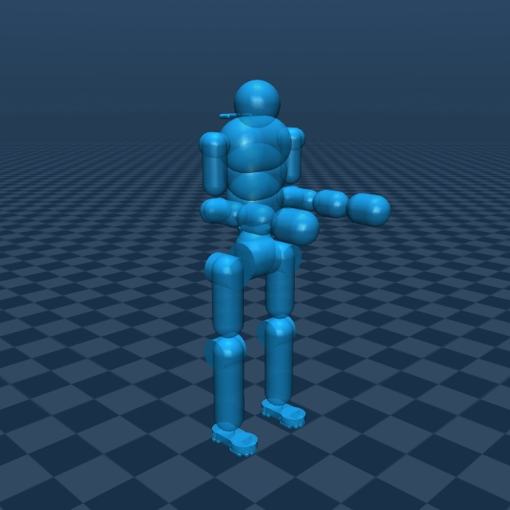

# Astro P2 Description (MJCF)

> [!IMPORTANT]
> Tested with MuJoCo 3.11.0, the version pinned by this repository.

## Changelog

Model history: [CHANGELOG.md](CHANGELOG.md).

## Overview

Astro P2 has one fixed-head 29-DoF body with two maintained hand configurations.
The default uses Astro's fixed hands. **Astro P2 with hands** adds 14 Unitree
Dex3-1 finger joints for 43 total DoFs; its hand meshes use silver coloring.

  
  

| Model | Body DoFs | Hand DoFs | Scene |
| --- | --- | --- | --- |
| [astro_p2.xml](astro_p2.xml) — Astro P2 | 29 | 0 | [scene.xml](scene.xml) |
| [astro_p2_with_hands.xml](astro_p2_with_hands.xml) — Astro P2 with hands | 29 | 14 | [scene_with_hands.xml](scene_with_hands.xml) |

DoF counts exclude the floating base. Previews use native reference
initialization without simulation stepping.

## MJCF derivation steps

1. Retained the refined Astro/Dex3-1 MJCF body, including masses, inertias,
   joints and source coordinate frames; fixed the head for a 29-DoF body.
2. Consolidated models and shared meshes into this self-contained family.
   Each scene includes its sibling robot XML and a floor at `z=-0.75`.
3. Restored original Astro hand meshes, fixed-joint transforms and inertias
   for the default model. The earlier G1 hand trial was superseded.
4. Preserved the articulated model's 14 finger joints, physics and `fist`
   keyframe. Its public label is Astro P2 with hands.
5. Tuned the default palms, wrist capsules, shin capsules and upper pelvis
   cylinder. Merged axial upper-arm capsules and attached them to shoulder-roll
   for automatic forearm contacts. The maintainer's final upper-arm centerlines
   are `0 0 0 0 0 -0.12`, with radii 0.037 m left / 0.039 m right.
6. Retired the separate simplified collision variant after the default design
   was approved. Its XML, scene, previews and derivation record are frozen under
   [provenance/retired_simplified/](provenance/retired_simplified/README.md).
   They are historical evidence, outside the active catalog and native checks.

## Collision geometry

The approved default has **52 collision geoms** and **37 visual mesh geoms**.
Group 1 contains visual meshes with collision disabled; group 3 contains
collision primitives with automatic contact masks enabled. Viewer visibility
changes do not disable contact.

Each continuous upper-arm capsule belongs to the shoulder-roll body. A real
shoulder-yaw body separates it from the forearm-owning elbow body, allowing
normal automatic contact. There are **no explicit contact pairs or elbow-stop
proxy spheres**. The existing left/right elbow-to-wrist-pitch body exclusions
avoid permanent overlap of those neighboring envelopes. All other contact
filtering remains native; automatic contacts use frictional `condim=3` settings.

The palm capsules have radius 0.05 m and wrist-yaw-frame centerlines x=0.10–0.15 m.
Extended fingers/thumb intentionally lie outside this approximation. Each shin
centerline is `0.015 0 -0.24 0.015 0 0.003`; the proximal extension starts knee
contact near −3.88°, before the −5.16° native limit. The upper pelvis cylinder
has radius 0.057 m, half-length 0.018 m and center z=0.10 m.

  

Contacts and angle limits are compliant. Existing thigh–shin contact near
133.3° still precedes the configured 139.8° knee maximum. No hardware contact
calibration, performance improvement or powered-controller stability is claimed.
The articulated-hand model retains its own earlier collider configuration;
these default-model refinements are not synchronized into it.

## Model notes

Neither model supplies actuators or gains. The default has `nq=36`, `nv=35`
and mass **40.58255359 kg**; the articulated model has `nq=50`, `nv=49` and mass
**41.69666115 kg**. Both use a 0.002 s timestep and Euler integration. Select
`fist` explicitly for the articulated closure; ordinary reset uses the reference
configuration. Dex3-1 attachments are samples, not verified mechanical adapters.

Mesh hashes, hand inertias and current collision provenance are recorded in
[provenance/rubber_hands.json](provenance/rubber_hands.json). Original conversion
notes under [provenance/29dof/](provenance/29dof/MJCF.md) and
[provenance/dex3_1/](provenance/dex3_1/DERIVATION.md) are historical evidence;
their old build commands are not supported regeneration steps. Edit root XML
directly. [Final verification](../docs/astro-p2-collision-retirement.md) records
approval preservation and retirement checks.

Workbench, URDF compatibility and MJX runtime remain deferred.

## License

The Astro P2 body and default model are released under the
[Apache License, Version 2.0](LICENSE). The articulated alternative combines
Apache-2.0 Astro body material with Unitree hand material under
[BSD-3-Clause terms](LICENSE.Unitree). See [LICENSING.md](LICENSING.md).
