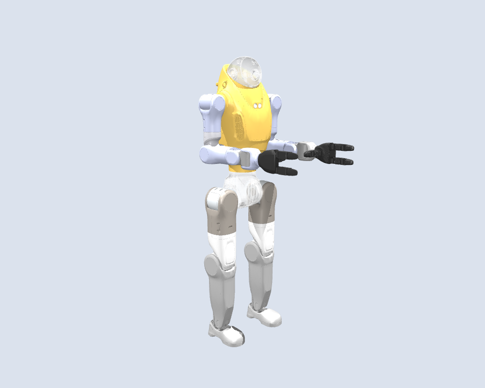
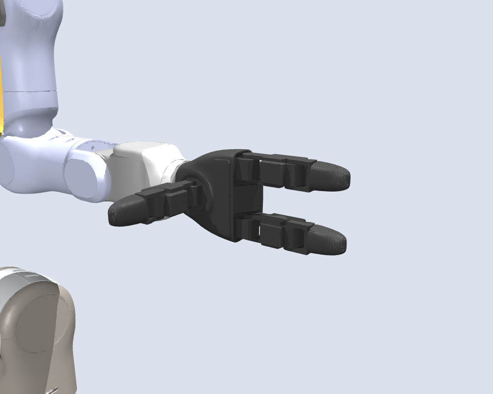
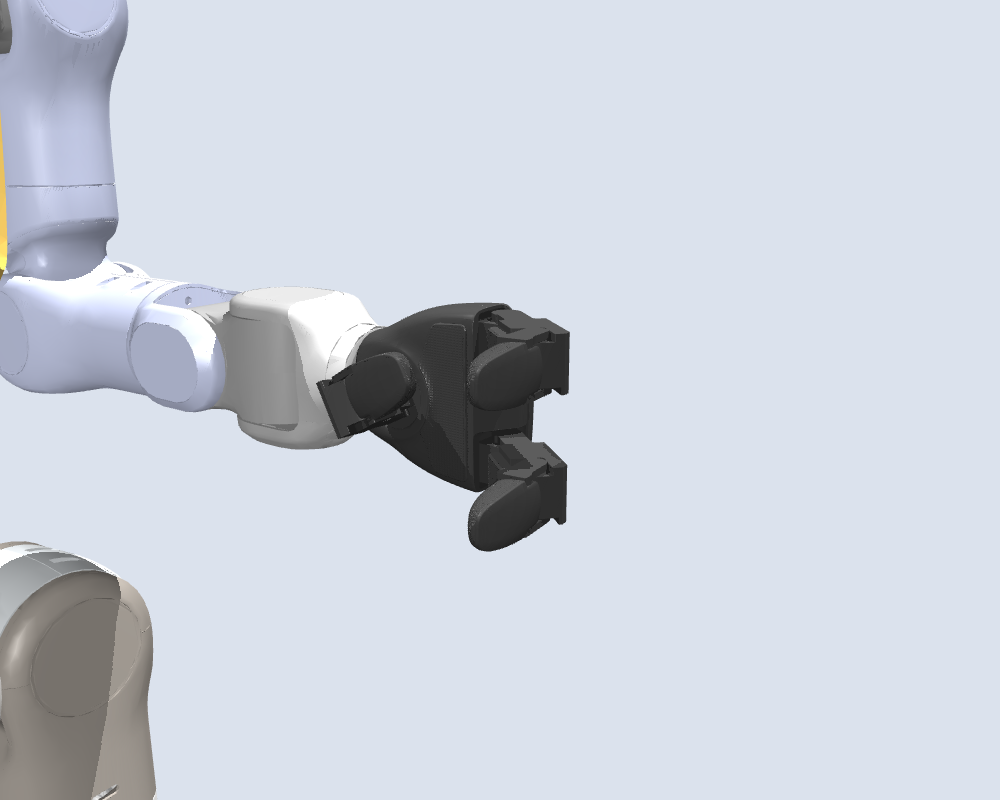
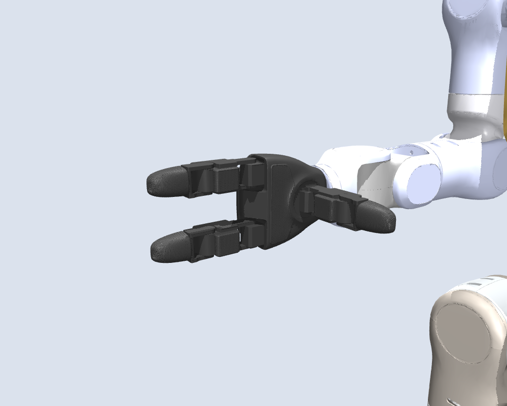
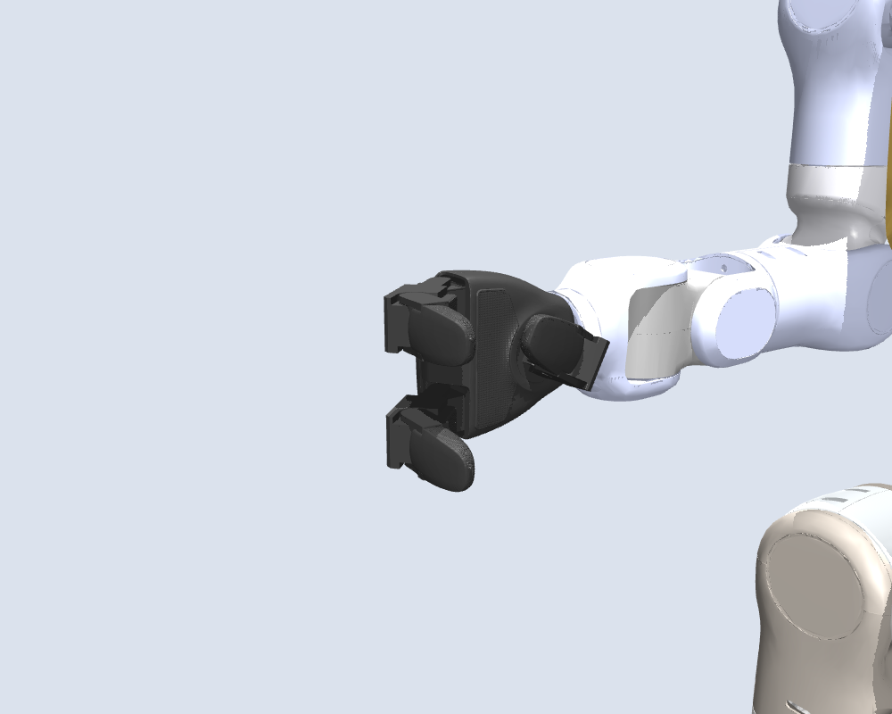

# Astro P2 with Unitree Dex3-1 sample hands

This separate **43 DOF** variant preserves Astro P2's fixed-head 29 DOF body and
adds official left/right Unitree Dex3-1 hands (seven joints each). The original
`../astro_p2_29dof` bundle is unchanged. The catalog exposes both URDF and MJCF.



## Sources and fidelity

Unitree identifies Dex3-1 as G1's optional three-finger dexterous hand. Geometry,
internal transforms, axes, joint limits, effort/velocity fields and inertias are
from the official standalone Dex3-1 URDFs at Unitree ROS revision
`5994d4faef0a9cadd3287f8de0199a67eeb2a259`. See
[the source review](../docs/robots/astro-three-finger-hand-research.md) for
primary citations and signed joint limits. Vendor URDF snapshots are retained
verbatim in `upstream/` as source records; their original mesh paths are relative
to the upstream tree. The assembled root-level URDF and MJCF are runnable here.
The 16 vendor STL files are unchanged in `meshes/`; `LICENSE.Unitree` retains the
BSD-3-Clause notice. `SOURCE.json` records all source hashes and modifications.
Astro visual meshes are copied unchanged from the baseline bundle.

## Sample mounting assumption

The original `left_hand_link` and `right_hand_link` frames remain fixed at
67.502/67.500 mm along wrist-yaw +X. They are now **empty, massless frames**:
the old 54 mm sphere and surrogate hand inertia are removed. Each official palm
root attaches at that frame with identity XYZ/RPY, using explicitly named
`*_dex3_sample_adapter_joint` fixed joints. Thus the palm +X extends distally
along the forearm; official left/right chirality and finger frames are retained.

This is a kinematic sample adapter, with no fabricated adapter geometry or mass.
It is not a verified mechanical mount. Bolt pattern, flange fit, fasteners,
actual adapter length/orientation/mass, cables, wrist torque capacity and whole
robot clearances require hardware measurements. G1's own wrist-to-palm offset
(41.5 mm forward and ±3 mm lateral) is evidence about G1, not an Astro adapter.
The underlying Astro arms, wrist housings, torso, handle, feet and inertias are
preserved exactly.

## Geometry, inertia and coordinates

Visuals use official hand STL geometry. Hand collisions use **one capsule per
finger link (14 total) and one simple box per palm**. Each capsule follows the
longest mesh-bound axis, with radius equal to half the larger transverse extent;
its rounded ends preserve the segment's overall longitudinal extent. The six
distal capsules instead use a 9.5 mm radius to follow the narrower rounded core
and stop 4 mm before the mesh tip. Thick side pads and the irregular final tip
are intentionally not fully covered. These are
rounded approximations, not guaranteed enclosing hulls or validated grasp/contact
models. URDF uses a cylinder plus two spheres; MJCF uses native capsules.
`hand-collision-shapes.json` records all dimensions and endpoints.
Existing body collisions retain their exact geometry; the MJCF
collapses the same 39 cylinder/sphere assemblies into native capsules, including
eight sole capsules plus three side primitives per foot.

The vendor model mass is **0.69654599 kg per hand**, differing from the advertised
0.710 kg. Vendor per-link inertias are retained without rescaling. Total mass is
**41.69666115 kg** = baseline 40.58255359 − old hands 0.27898442 + new hands
1.39309198 kg. The sample adapters contribute zero mass. MJCF sets
`inertiafromgeom=false`, preventing collision envelopes from adding mass. The
URDF carries the same MuJoCo compiler setting, so direct imports retain the
same mass as the native MJCF. URDF velocity fields are preserved as metadata;
MJCF does not enforce them as velocity constraints.

`joint-order.json` separates the unchanged 29-joint body order from the left and
right seven-joint hand orders; `robot.yaml` lists this combined application
order. Native MJCF order follows tree traversal and places left fingers before
the right arm, so map by **joint name**, not by an assumed shared array order.
`validation.json` includes both orders. Free-base coordinates are separate
(`nq=50`, `nv=49`, 43 hinges + free joint). There are no actuators or gains.

No HHTools calibration, retargeting, finger mapping, controller, tactile sensors,
or hardware communication is provided or claimed. This `robot.yaml` is a sample
asset descriptor, not evidence of HHTools hand support.

## Rebuild and validation

From the repository root:

```sh
.venv/bin/python scripts/build-astro-dex3-variant.py
.venv/bin/python scripts/build-astro-mjcf.py --bundle astro_p2_43dof_dex3_1 --catalog-paths
.venv/bin/python scripts/validate-astro-dex3-variant.py
MUJOCO_GL=egl .venv/bin/python scripts/render-astro-dex3-preview.py
```

The build is offline and uses the bundled pinned source records. Validation
compares all untouched body links/joints, vendor internal joints and inertias,
mesh hashes/paths, mass accounting and named-joint limits. It compiles the URDF
and MJCF with MuJoCo 3.11.0 and compares body frames at zero plus ten deterministic
random configurations spanning signed limits. The maximum frame error is below
4e-7 (metres for position, unitless for rotation matrix elements). It also
regenerates the original 29 DOF MJCF in a temporary directory and checks that
both the XML and conversion report are byte-identical to the baseline.

These checks validate description consistency, not hardware dynamics, stable
free simulation, hand contact behavior or a collision-free operating envelope.

| Open left | Bent left |
|---|---|
|  |  |

| Open right | Bent right |
|---|---|
|  |  |

## Later MJCF-only refinement

The MJCF has additional shin/foot and palm/thumb-root contact refinements, while the URDF remains at the approved prior geometry. See [MJCF.md](MJCF.md) before regenerating: the conversion command above overwrites these MJCF-only adjustments. The sole and distal finger collisions are identical in both editions.

The MJCF-only refinement also improves torso, upper-arm and wrist coverage; see `MJCF.md` and `mjcf-refinement.json` for geometry changes and static contact checks.

The latest MJCF provides a `fist` keyframe and `fist-pose.json` for matching hand closure. The review viewer loads it by default and exposes linked hand closure; see `MJCF.md` and `mjcf-fist-review.json` for palm changes and validation.

## Menagerie entry points

| Edition | Internal DOF | Descriptions |
| --- | --- | --- |
| `43dof_primitive_collision` | 43 | [URDF](astro_p2_43dof_dex3_1.urdf) · [model](astro_p2_43dof_dex3_1.xml) / [scene](scene.xml) |

The family-root model and scene XML are canonical and maintained directly.
Scenes include a sibling robot model and add presentation lighting and one
ground plane. Robot frames and physical descriptions are unchanged; the floor
is lowered where needed to preserve the original zero-height robot datum.
Meshes live in `assets/`, with the retained relative `meshes -> assets` alias.
Nested `mjcf/` imports, where present, are preserved source snapshots.
Workbench, URDF compatibility, and MJX are deferred; legacy application edits
may target those snapshots and do not update the canonical native XML.

See [LICENSING.md](LICENSING.md) for asset-specific terms and unresolved provenance.
