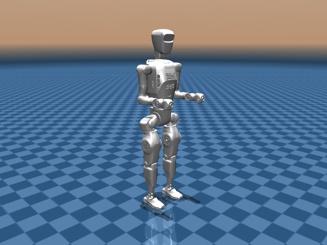

# Atom P3 Description (MJCF)

> [!IMPORTANT]
> Tested with MuJoCo 3.11.0, the version pinned by this repository.

## Changelog

Model history: [CHANGELOG.md](CHANGELOG.md).

## Overview

This directory contains the retained 27-DoF, free-base Atom P3 MJCF. The source
is recorded as internal in the [legacy manifest](../manifest.json), including
the original SHA-256. No public upstream derivation is recorded.

  

| Model | DoFs | Scene |
| --- | --- | --- |
| [atom_p3_27dof.xml](atom_p3_27dof.xml) | 27 | [scene.xml](scene.xml) |

DoF counts exclude the floating base. Open the scene to include the robot,
ground plane, and lighting. The images show native reference initialization,
without advancing simulation.

## MJCF derivation steps

1. Preserved the imported [Atom P3 MJCF](mjcf/atom_p3_27dof.xml) as a source snapshot.
2. Placed the maintained model at the family root and changed its mesh lookup to `assets/`.
3. Retained the imported geometry, masses, inertias, joint ranges, and sensor definitions.
4. Added `scene.xml` with a ground plane at `z=0` and presentation lighting.

## Model notes

The model has `nq=34`, `nv=33`, 87 sensor declarations, and no actuators
(`nu=0`). Loading and short simulation checks do not establish a usable
controller. No URDF is supplied. Edit the root XML directly; the nested MJCF
remains source evidence.

## License

No explicit redistribution license accompanies the internal Atom bundle.
See [LICENSING.md](LICENSING.md) for provenance status and scene attribution.
